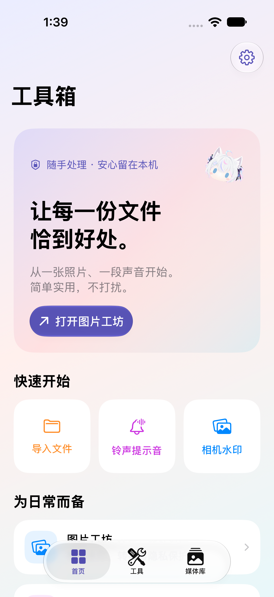
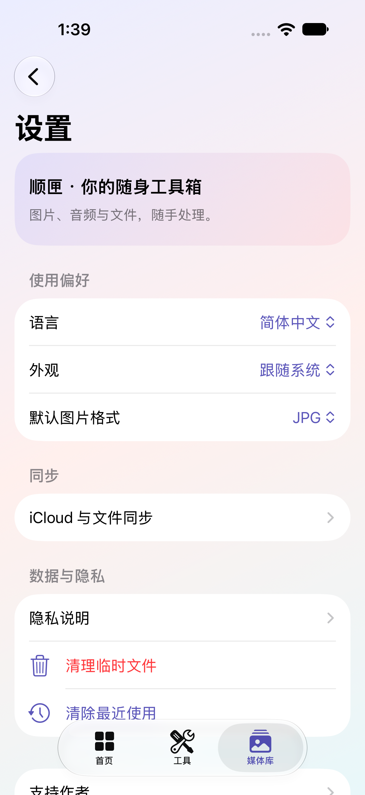

<div align="center">
  
  <h1>顺匣 · ShunBox</h1>
  <p><strong>你的随身工具箱。</strong><br>图片、音频与文件，随手处理。</p>
  <p>原生 SwiftUI &nbsp; · &nbsp; iOS 26+ &nbsp; · &nbsp; 本地处理 &nbsp; · &nbsp; 免费无广告</p>
  <p>
    <a href="https://github.com/sqzr74110/ShunBox/releases"><strong>下载 IPA</strong></a> &nbsp; / &nbsp;
    <a href="Docs/INSTALL.md">安装指南</a> &nbsp; / &nbsp;
    <a href="https://github.com/sqzr74110/ShunBox/issues">反馈问题</a> &nbsp; / &nbsp;
    <a href="Docs/SUPPORT.md">支持顺顺</a>
  </p>
</div>

---

一张照片，一段声音，一份文件。顺匣把 iPhone 上常见的小事放进一个轻量工具箱：导入、处理、预览，作品留在自己的设备里。

> **公开测试版。** GitHub 版所有功能免费、不限次数、无广告，无需应用账户。下载的 IPA 需要自行签名，不能直接点击安装；未在 App Store 发布。[了解安装方式 →](Docs/INSTALL.md)

<div align="center">
  
  &nbsp;
  
  <p><sub>真实运行截图 · 柔和色彩，清楚的层次。</sub></p>
</div>

## 随手处理，留在本机

| 图片与摄影 | 声音与铃声 | 文件与日常 |
| :--- | :--- | :--- |
| 批量转格式、压缩、移除来源元数据 | 波形裁剪、淡入淡出、视频提取声音 | PDF 合并与提取、重命名副本 |
| 玻璃胶囊 / 黑白边框 / 文字水印 | M4A、M4R、WAV、AIFF、CAF 导出 | 本机媒体库、筛选、搜索、预览与分享 |
| 真实相机与曝光参数、多图转 PDF | 麦克风实时波形与电平自检 | 二维码、设备信息、屏幕与触控自检 |

**按你的习惯工作。** 支持浅色与深色、App Shortcuts / Siri 入口，以及用户选择的 iCloud Drive 文件夹同步。九种界面语言默认跟随设备，也可手动选择。

<details>
<summary>支持的语言与能力边界</summary>

简/繁中文、英文、日文、韩文、法文、德文、西班牙文、巴西葡萄牙文；未覆盖语言回退英文。

图片格式取决于本机 Apple 编码器，缺失的相机参数不会伪造。铃声安装使用系统允许的分享方式或 GarageBand，不使用私有接口。设备自检不鉴定原装、拆修、电池健康或声纹身份。

</details>

## 安装与构建

IPA 在 GitHub Releases，标为 `unsigned`，**不能从 Safari 下载后直接安装**。使用支持自行签名的侧载工具，或者用 Mac 上的 Xcode 从源码安装。免费 Apple 账号有设备、应用数量与签名有效期限制；以 Apple 和签名工具实际提示为准。详见[安装说明](Docs/INSTALL.md)。

开发环境：本项目在 Xcode 27.1 / iOS 27 模拟器与 iPhone 上开发，部署目标为 iOS 26。需要支持当前 SwiftUI / App Intents API 的 Xcode，未验证旧版本 Xcode。

```sh
open ShunTools.xcodeproj
# Xcode 选 ShunTools scheme 和模拟器；真机安装需选择自己的 Team。
# 如增加源文件，可重新生成工程（会覆盖项目内自定义配置）：
python3 Scripts/create_project.py
# 构建 Release IPA，不申请证书、不嵌入个人描述文件：
python3 Scripts/package_ipa.py
```

输出在 `dist/`，包含 IPA 和 SHA-256 校验文件。源码默认定义 `SIDELOAD`：不请求 StoreKit 商品、不展示购买与恢复入口、不开启广告。未来 App Store 路线的 StoreKit/广告策略代码仍保留，但它们不代表已接入真实广告或线上收款；App Store 发行需单独配置和审核。

## 验证与限制

- 包含图片、PDF、音频、二维码、同步、文件名保护、媒体库与预览回归测试；Xcode ⌘U 运行。
- 部分照片导入 UI 测试需先往模拟器照片库添加样本。预览回归会在 Debug 模拟器中生成样本，不会在真机或 Release 中运行。
- StoreKit 购买测试在 `SIDELOAD` 构建中跳过。自动化不代替真实麦克风、触感、铃声安装、云端上传、Siri 语音和侧载工具兼容性验证。
- 图片输出为 SDR；动画仅处理第一帧。媒体库为本机文件，卸载会删除，重要作品请另行导出。
- 设备自检不是专业验机认证；波形和 dBFS 是录音信号强弱，不是声纹身份识别或校准声压计。
- 这是早期测试版，欢迎带复现步骤反馈问题。不要在公开 Issue 上传私密照片、声音、设备标识或签名资料。

## 如果顺匣帮到了你

代码会继续开放，工具保持免费。如果你愿意，可以请顺顺喝杯饮料，支持后续维护。

**[爱发电支持顺顺 ↗](https://afdian.com/a/sqzr74110)** &nbsp; · &nbsp; [支付宝 / 微信收款码](Docs/SUPPORT.md) &nbsp; · &nbsp; [原赞助页面](https://vrchat.shunfishingtime.ink/support)

赞助完全自愿，不解锁功能，不是订阅，也不影响免费使用。

## License

代码、脚本、文档：**MIT**，见 [LICENSE](LICENSE)。角色图、图标、吉祥物及品牌 **不包含在 MIT 中**，见 [ASSETS-LICENSE.md](ASSETS-LICENSE.md)。修改后发行请使用自己的视觉素材和品牌。

---

**English:** ShunBox is a native SwiftUI iPhone toolkit for images, audio, PDF and everyday files. This GitHub build is free and ad-free. iOS 26+ is required. Release IPAs are unsigned and require your own signing; this is not an App Store or one-tap installation. Source code is MIT licensed; character artwork, icons and branding are reserved separately. See the installation and asset-license documents before redistributing a fork.
